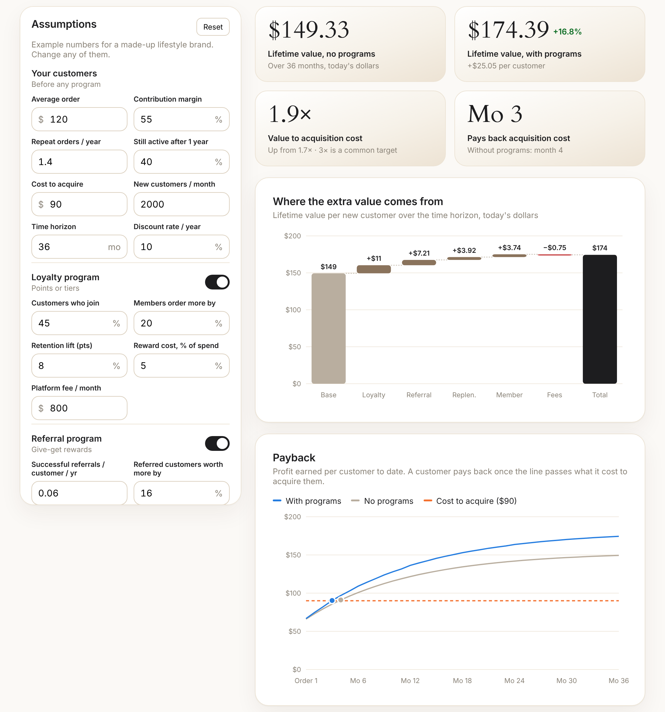

# Loyalty, Referral & Subscription CLV Model

**What is each customer really worth, and what does each retention program add?** Model a loyalty program, a referral program, a replenishment subscription and a paid membership. See their effect on customer lifetime value (CLV) after rewards, discounts, perks and platform fees, plus how fast a new customer pays back what it cost to acquire them.

**[Live demo →](https://adela-lam-clv-model.vercel.app)** · Built by [Adela Lam](https://adelawlam.wordpress.com), brand & marketing leader



---

## Why I built it

Retention vendors pitch features. Finance asks one question: **what does it add per customer, after it pays for itself?** Most business cases answer with a single blended "loyalty lifts CLV by X%" figure that's hard to pressure-test.

This model splits the answer by program and by assumption. It shows which program earns its fee, which assumptions the result depends on, and how much retention or order frequency a program has to move to be worth it. It's the approach behind the loyalty and referral evaluation work in my [Lifecycle & Loyalty case study](https://adelawlam.wordpress.com/lifecycle-loyalty/). All numbers in the demo are made up.

## What it models

| Program | Levers | Costs counted |
|---|---|---|
| **Loyalty** | Join rate, extra orders, retention lift | Rewards as % of member spend, platform fee |
| **Referral** | Successful referrals per customer, referred-customer premium | Rewards to both sides, platform fee |
| **Replenishment subscription** | Adoption, ship frequency, order value, cancellation rate | Subscriber discount, orders that would have happened anyway, app fee |
| **Paid membership** | Adoption, yearly fee, renewal rate, extra orders | Perk cost per member, platform fee |

**Outputs:** CLV with and without programs, CLV-to-acquisition-cost ratio, payback month, a waterfall of where the value comes from, a program-by-program table and a sensitivity chart of the assumptions that matter most.

## How it works

Each new customer is modelled month by month as **contribution** (revenue × margin, after program costs), discounted to today. Month 0 is the first order.

```
baseline       = first order + Σ survival(t) × (orders per year ÷ 12) × AOV × margin × discount(t)
loyalty        = join rate × (member stream − baseline stream)
                 members: orders × (1 + lift), retention + lift pts, margin − reward cost
referral       = Σ survival(t) × (referrals per year ÷ 12) × discount(t) × (baseline CLV × (1 + premium) − rewards)
replenishment  = adoption × Σ every n months: (1 − churn)^t × [(1 − c) × value × (margin − discount) − c × value × discount] × discount(t)
                 c = share of subscription orders that would have happened anyway
membership     = adoption × [ Σ yearly: renewal^y × (fee − perk cost) + Σ monthly: extra member orders × AOV × margin ]
CLV            = baseline + programs − (monthly platform fees ÷ new customers per month)
```

Survival uses a constant monthly rate derived from annual retention, following the retention-based approach in Gupta, Lehmann & Stuart (2004).

### Checked two ways

- **Unit tests** ([`test/model.test.mjs`](test/model.test.mjs)) check each stream against hand calculations: the closed-form geometric series for the baseline, 4 replenishment orders a year with and without cannibalisation, membership fees with renewals, and the full CLV and payback.
- **Independent recalculation:** the demo defaults were recomputed separately and match to the cent (baseline $149.33 → $174.39 with programs, +16.8%).

## Assumptions to know

- Programs are treated as **independent**, so their gains add up. Real programs overlap (a subscriber is often also a loyalty member), so read the total as an upper bound and the per-program numbers as the decision guide.
- Referred customers are valued at baseline CLV plus a premium. **Their own referrals aren't counted**, which keeps referral value conservative.
- Platform fees are fixed monthly costs spread across each month's new customers.

## Research behind the defaults

- Schmitt, P., Skiera, B. & Van den Bulte, C. (2011). [Referral Programs and Customer Value](https://journals.sagepub.com/doi/10.1509/jm.75.1.46). *Journal of Marketing*, 75(1). Referred customers were about 16% more valuable, which is the default premium.
- Kumar, V., Petersen, J. A. & Leone, R. P. (2007). [How Valuable Is Word of Mouth?](https://hbr.org/2007/10/how-valuable-is-word-of-mouth) *Harvard Business Review*.
- Reichheld, F. F. & Sasser, W. E. (1990). [Zero Defections: Quality Comes to Services](https://hbr.org/1990/09/zero-defections-quality-comes-to-services). *Harvard Business Review*.
- Gupta, S., Lehmann, D. R. & Stuart, J. A. (2004). [Valuing Customers](https://doi.org/10.1509/jmkr.41.1.7.25084). *Journal of Marketing Research*, 41(1).

## Run it locally

No install needed. It's plain HTML, CSS and JavaScript.

```bash
npm run dev    # preview on http://localhost:3000
npm test       # unit tests for the model
```

## License

MIT
